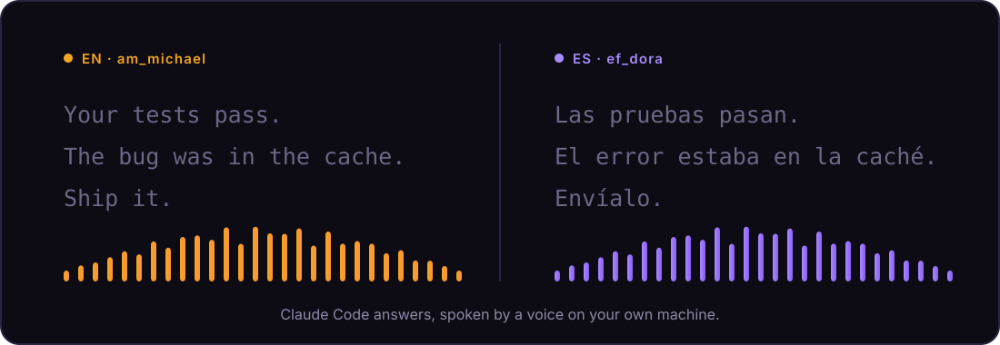
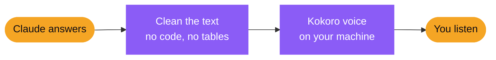

<p align="center">
  
</p>

<h1 align="center">read-aloud-mod</h1>

<p align="center">
  <b>Stop reading. Start listening.</b><br>
  Claude Code answers, spoken by a free voice that runs on your own machine.
</p>

<p align="center">
  
  
  
  
  
</p>

<p align="center">
  <a href="#install">Install</a> &nbsp;·&nbsp;
  <a href="#use">Use</a> &nbsp;·&nbsp;
  <a href="#how-it-works">How it works</a>
</p>

https://github.com/user-attachments/assets/d30c05c9-e1e1-4f54-b25f-272cd7706135

<p align="center">
  
</p>

<table>
  <tr>
    <td width="33%" valign="top"><b>Private</b><br>The voice runs locally. No text or audio is sent to a cloud service.</td>
    <td width="33%" valign="top"><b>Complete</b><br>Reads the whole answer, not a summary. Code and tables become a short spoken cue.</td>
    <td width="33%" valign="top"><b>One keystroke</b><br>Turn it on, stop it, repeat it or change the speed without leaving the prompt.</td>
  </tr>
</table>

## Install

```text
/plugin marketplace add devsergioherrera/read-aloud-mod
/plugin install read-aloud@read-aloud
/read-aloud setup
```

`/read-aloud setup` opens a short guide above the prompt. It asks what you want (English, Spanish, or both), checks that [`uv`](https://docs.astral.sh/uv/getting-started/installation/) and an audio player are there and tells you the exact fix if not, lets you pick a voice, installs it once (about 120 MB), and plays a sample so you can say yes or change it. Read-aloud is **off** until you finish the guide or switch it on.

Prefer no guide? `/read-aloud setup en`, `es` or `both` installs straight away.

| Platform | Also needs | Status |
| :-- | :-- | :-- |
| Ubuntu / Linux | `paplay`, `aplay` or `ffplay` |  |
| Windows 10 / 11 | PowerShell (built in) and `winget install astral-sh.uv` |  |

## Use

Press <kbd>ctrl</kbd> + <kbd>x</kbd>, then <kbd>Tab</kbd>, then one key. The row above the prompt shows them.

> [!TIP]
> The keys need the row to be visible. If you see `plugin panel hidden`, press <kbd>ctrl</kbd> + <kbd>x</kbd>, <kbd>ctrl</kbd> + <kbd>a</kbd> to show it first. After <kbd>ctrl</kbd> + <kbd>x</kbd>, <kbd>Tab</kbd> one button lights up. That means the row has focus.

| Key | Does | Command |
| :-: | :-- | :-- |
| <kbd>m</kbd> | Switch reading on or off | `/read-aloud toggle` |
| <kbd>s</kbd> | Stop talking | `/read-aloud stop` |
| <kbd>r</kbd> | Repeat the last answer | `/read-aloud now` |
| <kbd>f</kbd> | Faster | `/read-aloud speed faster` |
| <kbd>l</kbd> | Slower | `/read-aloud speed slower` |

Type `/read-aloud` followed by a space to see every option as you type, or run `/read-aloud help` for the full list. Typing in the prompt never interrupts the voice. Sending a new prompt does.

## English and Spanish

Two languages, each with its own voices. The spoken cues ("look at the code on screen") follow the language too.

| Language | Voices | Set with |
| :-- | :-- | :-- |
| English | `am_michael`, `am_fenrir`, `am_puck` · `af_heart`, `af_bella`, `af_nicole` | `/read-aloud lang en` |
| Español | `em_alex`, `em_santa` · `ef_dora` | `/read-aloud lang es` |
| Both | the voice follows each answer | `/read-aloud lang auto` |

`auto` reads each answer's words to decide the language, a simple guess that defaults to English. Pick a voice with `/read-aloud voice ef_dora`, or `male` / `female` for the current language.

<details>
<summary><b>Voice, speed and length</b></summary>

<br>

| Setting | Command | Default |
| :-- | :-- | :-- |
| Voice | `/read-aloud voice male \| female \| <name>` | `am_michael` / `af_heart` |
| Speed | `/read-aloud speed faster \| slower \| 1.3` | `1.3` |
| Spoken answer length | Config menu, `spokenWords` | 100 words |

While read-aloud is on, Claude is asked to keep answers short enough to listen to. Ask for more detail and it will give it.

</details>

## How it works



A hook waits for each finished answer, turns the markdown into plain sentences, and streams it sentence by sentence to a local [Kokoro](https://github.com/thewh1teagle/kokoro-onnx) voice, so you hear the first words quickly.

<p align="center">
  <br>
  <sub>Made by <a href="https://github.com/devsergioherrera">Sergio Herrera</a></sub>
</p>
